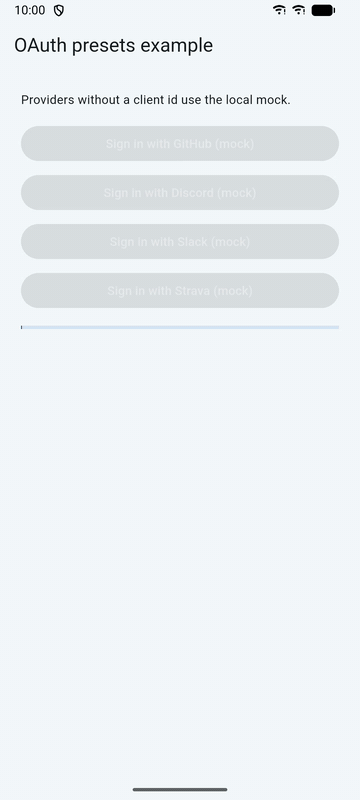

# flutter_social_login

<p align="center">
  
</p>

<p align="center">

[](https://pub.dev/packages/social_auth_core) [](https://github.com/franciscodlx/flutter_social_login/actions/workflows/ci.yml) [](LICENSE)

</p>

**Agrega "Iniciar sesión con GitHub, X, LinkedIn, TikTok…" a tu app de Flutter con una sola API: navegador del sistema, PKCE y cero secrets en la app.**

Sin WebView: el usuario inicia sesión en `ASWebAuthenticationSession` (iOS) o Custom Tabs (Android), con las cookies y gestores de contraseñas que ya usa. El `client_secret` se queda en tu backend, y los errores llegan normalizados (`CANCELLED`, `NETWORK`, `PROVIDER_ERROR`…) sin importar el proveedor.

## Instalación

```sh
flutter pub add social_auth_x
```

En Android agrega el esquema de tu app en `android/app/build.gradle.kts` (`manifestPlaceholders["authCoreRedirectScheme"] = "miapp"`) y el permiso `INTERNET` si tu app aún no lo tiene. iOS no necesita configuración.

## Ejemplo mínimo

```dart
import 'package:social_auth_x/social_auth_x.dart';

final session = await xLogin.signIn(const SignInOptions(
  clientId: 'TU_CLIENT_ID',        // portal de X → OAuth 2.0, app tipo "Native App"
  redirectUri: 'miapp://callback', // regístrala tal cual en X
  exchangeCode: true,              // cliente público: el canje se hace en el dispositivo con PKCE
));

print('Hola, @${session.profile?.username}');
```

X es un cliente público, así que este ejemplo no necesita backend. LinkedIn, GitHub, TikTok y los demás devuelven un `code` que tu backend canjea con el secret; cada paquete trae el canje listo en Node y Laravel. Detalles de X en [`packages/social_auth_x`](packages/social_auth_x).

<sub>El GIF: Ejemplo de `social_auth_presets` en el emulador de Android contra el proveedor local (`tools/mock_idp`). Probado también con cuentas reales de LinkedIn, X, GitHub, Discord, Telegram y TikTok en iPhone y Android.</sub>

## Paquetes

| Paquete                                                                               | Qué hace                                                            | Estado                   |
| ------------------------------------------------------------------------------------- | ------------------------------------------------------------------- | ------------------------ |
| [`social_auth_core`](packages/social_auth_core)                                       | PKCE, `state`/`nonce`, navegador del sistema, errores normalizados  | Probado en iOS y Android |
| [`social_auth_core_platform_interface`](packages/social_auth_core_platform_interface) | Interfaz de plataforma y `AuthException`                            | —                        |
| [`social_auth_core_android`](packages/social_auth_core_android)                       | Implementación Android (Custom Tabs)                                | —                        |
| [`social_auth_core_ios`](packages/social_auth_core_ios)                               | Implementación iOS (Swift Package Manager y CocoaPods)              | —                        |
| [`social_auth_linkedin`](packages/social_auth_linkedin)                               | LinkedIn (OpenID Connect), canje en tu backend                      | Probado con LinkedIn     |
| [`social_auth_x`](packages/social_auth_x)                                             | X (Twitter), cliente público con PKCE, refresh y revocación         | Probado con X |
| [`social_auth_mercadolibre`](packages/social_auth_mercadolibre)                       | Mercado Libre (host por país, PKCE), canje en tu backend            | Probado contra el mock   |
| [`social_auth_twitch`](packages/social_auth_twitch)                                   | Twitch (OpenID Connect, `nonce`, `claims`), canje en tu backend     | Probado contra el mock   |
| [`social_auth_presets`](packages/social_auth_presets)                                 | GitHub, Discord, Slack y Strava, canje en tu backend                | Probado con GitHub, Discord |
| [`social_auth_telegram`](packages/social_auth_telegram)                               | Telegram (OpenID Connect + PKCE), canje en tu backend               | Probado con Telegram |
| [`social_auth_tiktok`](packages/social_auth_tiktok)                                   | TikTok (Login Kit, flujo web), canje en tu backend                  | Probado con TikTok (sandbox) |
| [`social_auth_entra_native`](packages/social_auth_entra_native)                       | Entra External ID native auth (pantallas propias, sin navegador)    | Probado contra el mock   |

El núcleo es un plugin federado: la app solo depende de `social_auth_core`, que trae las implementaciones de cada plataforma.

## Estructura

```
packages/social_auth_core                     lógica OAuth en Dart + app de ejemplo
packages/social_auth_core_platform_interface  contrato entre Dart y cada plataforma
packages/social_auth_core_android             Kotlin
packages/social_auth_core_ios                 Swift
packages/social_auth_<proveedor>              un paquete Dart por proveedor + app de ejemplo
tools/mock_idp                                proveedor OIDC local para probar sin credenciales
tools/mock_entra                              API de native auth de Entra, local
tools/<proveedor>_backend                     backend de ejemplo (redirect https + canje con secret)
```

Los paquetes de proveedor son Dart puro: no agregan código nativo. `package:social_auth_core/testing.dart` trae `FakeBrowser` para probar sin dispositivo.

## Desarrollo

Requiere Flutter ≥ 3.35 (probado con 3.50) y Node ≥ 22 para los servidores de `tools/`. Es un workspace de pub con [Melos](https://melos.invertase.dev).

```sh
flutter pub get        # resuelve todo el workspace
dart analyze .
dart format .
dart run melos run test
```

Ver [CONTRIBUTING.md](CONTRIBUTING.md) para correr el ejemplo.

## La familia

La misma API, los mismos proveedores y los mismos códigos de error en cada plataforma:

| Plataforma | Repositorio |
| ---------- | ----------- |
| React Native (y Expo) | [rn-social-login](https://github.com/franciscodlx/rn-social-login) |
| Flutter | **este repo** |
| Capacitor / Ionic | [capacitor-social-login](https://github.com/franciscodlx/capacitor-social-login) |
| NativeScript | [nativescript-social-login](https://github.com/franciscodlx/nativescript-social-login) |
| NativePHP Mobile | [nativephp-social-login](https://github.com/franciscodlx/nativephp-social-login) |

## Licencia

MIT.
